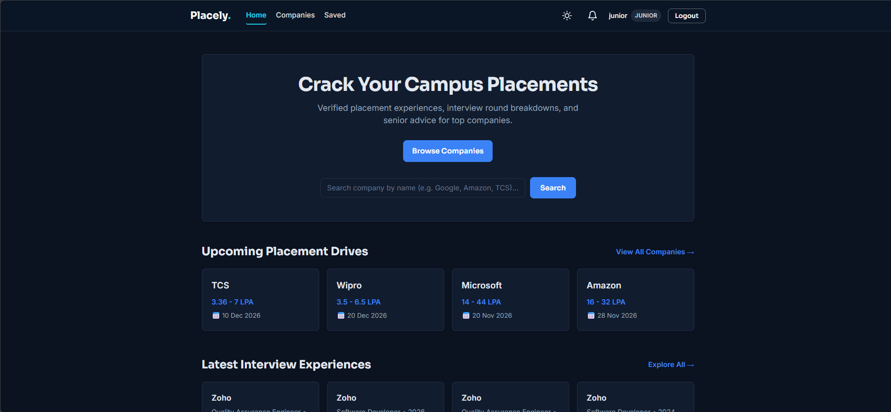
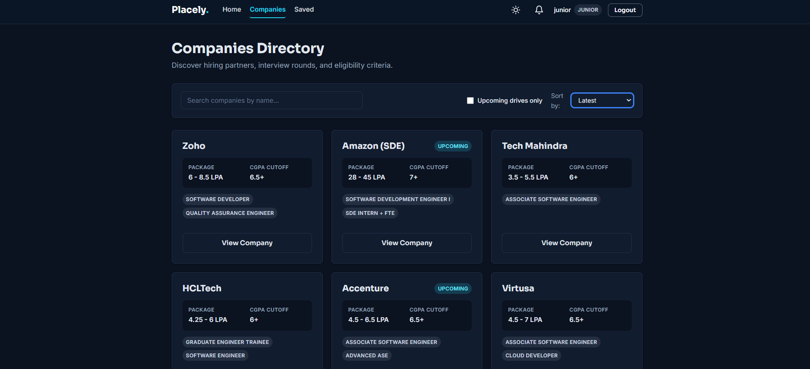
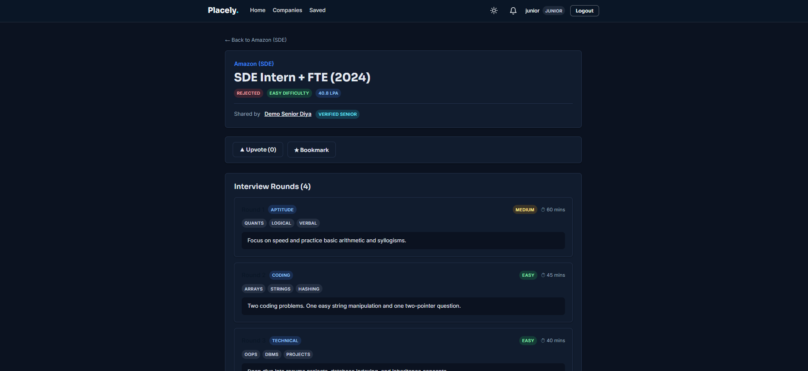
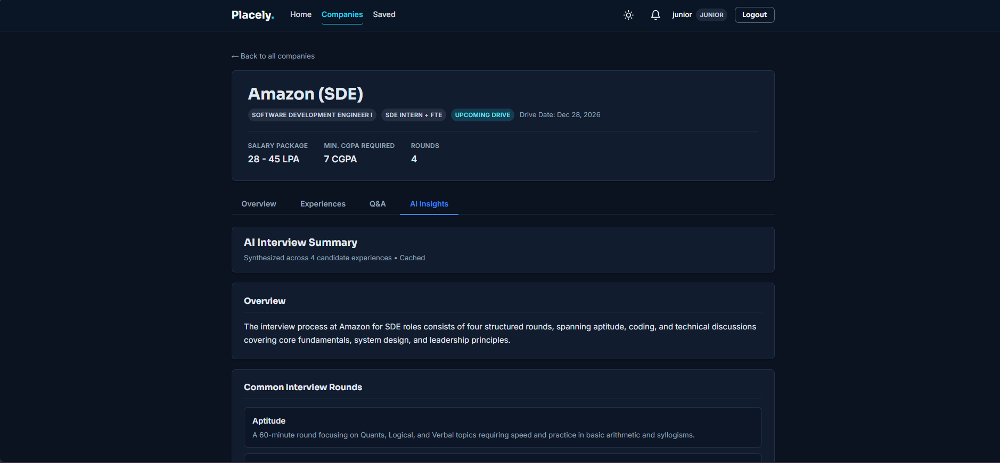
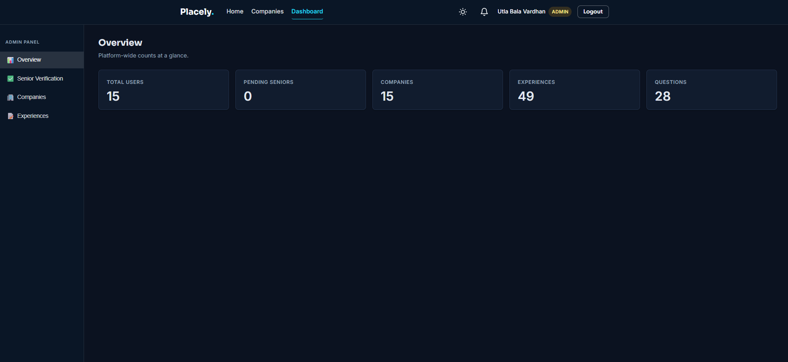
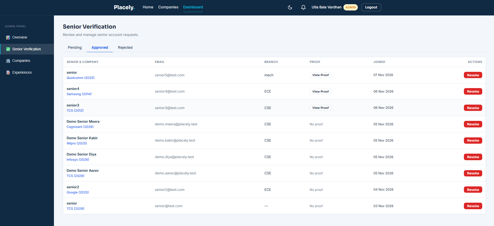

<div align="center">

# Placely

**Learn from seniors who cracked it. Prepare for campus placements with real, verified experiences.**


**Built by [Bala Vardhan Utla](https://github.com/Vardhan-12)** · B.Tech CSE, Lovely Professional University

[Live Demo](https://placely-xi-three.vercel.app) · [Report a Bug](https://github.com/Vardhan-12/Placely/issues)

</div>

---

## Table of Contents

[About](#about) · [Screenshots](#screenshots) · [Features](#features) · [Highlights](#highlights) · [Tech Stack](#tech-stack) · [Architecture](#architecture) · [Getting Started](#getting-started) · [Security](#security) · [Future Work](#future-work) · [Developer](#developer)

---

## About

Campus placements repeat every year: the same companies visit with similar rounds, yet the knowledge lives in scattered chat groups and disappears when seniors graduate.

**Placely** is a placement experience portal. **Verified seniors** share company-wise interview experiences, and **juniors** read them, ask questions and prepare with real data. Seniors prove their placement with a document, an admin reviews it, and only then can they post, which keeps the content trustworthy.

## Screenshots

### Home


### Companies


### Experience


### AI Insights


### Admin Dashboard


### Light Mode


## Features

### Junior (student)
- Browse companies with search, filters and sorting
- Read round-by-round experiences with difficulty, topics, tips and mistakes
- Upvote and bookmark experiences
- Ask company-specific questions and mark the best answer
- Generate an AI summary of a company's experiences

### Senior (placed student)
- Sign up with placement proof (PDF, JPG or PNG)
- Get notified on verification, or re-upload proof if rejected
- Post experiences with dynamic rounds, optionally anonymously
- Manage posts in **My Posts** (edit, delete)
- Answer questions from the **Questions for Me** inbox

### Admin
- Review pending seniors, view proof, approve, or reject with a reason
- Add, edit and delete companies and their rounds
- Moderate experiences and view platform statistics
- Get notified of new verification requests

## Highlights

| Feature | Description |
|---|---|
| Proof-based verification | Seniors are approved only after an admin reviews their document |
| In-app notifications | Bell with unread count for verification updates and requests |
| Anonymous posting | The author is hidden by the API itself, not just the UI |
| AI company summary | Gemini summarizes rounds, topics, tips and mistakes, with Groq fallback and caching |
| Dark and light theme | Saved preference, follows the system default |
| Live refresh | Status and lists refresh on focus and on a timer, with no re-login needed |

## Tech Stack

| Layer | Technology |
|---|---|
| Frontend | React (Vite), React Router, Axios, plain CSS with design tokens |
| Backend | Node.js, Express |
| Database | MongoDB Atlas, Mongoose |
| Authentication | JWT, bcrypt, role-based middleware |
| File uploads | Multer with type and size validation |
| AI | Google Gemini (primary), Groq (fallback), cached summaries |
| Security | Helmet, rate limiting, CORS allow-list |

## Architecture

```
placely/
├── client/                 React app
│   └── src/
│       ├── api/            Axios instance
│       ├── components/     Navbar, bell, tabs, shared UI
│       ├── context/        Auth and theme providers
│       ├── hooks/          Auto-refresh hook
│       ├── pages/          Home, Companies, Experiences, Admin, Profile
│       └── styles/         Design tokens and page styles
└── server/                 Express API
    └── src/
        ├── config/         Database connection
        ├── controllers/    Request logic
        ├── middleware/     Auth, roles, uploads, errors
        ├── models/         Mongoose schemas
        ├── routes/         URL definitions
        └── services/       AI provider calls
```

**Request flow:** React → Axios → Express → middleware (auth, role, validation) → controller → Mongoose → MongoDB

## Getting Started

**Prerequisites:** Node.js 18+, a MongoDB Atlas cluster, and optionally Gemini and Groq API keys.

```bash
# Clone
git clone https://github.com/Vardhan-12/Placely.git
cd Placely

# Backend
cd server
npm install
cp .env.example .env      # fill in your own values
npm run dev

# Frontend (new terminal)
cd client
npm install
npm run dev
```

The app runs at `http://localhost:5173` and proxies `/api` to the backend on port 5000.

### Environment variables

**server/.env**

| Name | Purpose |
|---|---|
| `PORT` | Server port |
| `MONGO_URI` | MongoDB Atlas connection string |
| `JWT_SECRET` | Secret for signing tokens |
| `JWT_EXPIRES_IN` | Token lifetime, e.g. `7d` |
| `ADMIN_SIGNUP_CODE` | Invite code to create an admin account |
| `CLIENT_URL` | Allowed frontend origin(s) for CORS |
| `GEMINI_API_KEY` | Gemini API key |
| `GEMINI_MODEL` | Primary Gemini model |
| `GEMINI_FALLBACK_MODEL` | Lighter model used if the primary is busy |
| `GROQ_API_KEY` | Groq API key (second fallback) |
| `GROQ_MODEL` | Groq model name |

**client/.env**

| Name | Purpose |
|---|---|
| `VITE_API_URL` | Backend API base URL in production |

> Never commit `.env` files. Only `.env.example` files with empty values belong in the repository.

## Security

- Passwords hashed with **bcrypt**, never returned by the API
- **JWT** auth; the user is re-loaded from the database on each protected request
- **Role middleware** separates junior, senior and admin actions
- Admin accounts require a server-side **invite code**
- Proofs validated for type and size, stored under random names, viewable only by admins
- Anonymous authors hidden by the API
- **Helmet**, request size limits and **rate limiting** on login and signup
- Secrets only in environment variables

## Future Work

- Threaded replies in Q&A
- Analytics charts per company
- Cloud storage for placement proofs
- Email notifications
- Google sign-in restricted to college domains

## Developer

**Bala Vardhan Utla** · B.Tech Computer Science and Engineering, Lovely Professional University

[GitHub](https://github.com/Vardhan-12) · [LinkedIn](https://www.linkedin.com/in/utla-bala-vardhan-0699b3282/)

Designed, built and tested end to end as a full-stack MERN project. Demo data in screenshots is sample data and does not represent real students.